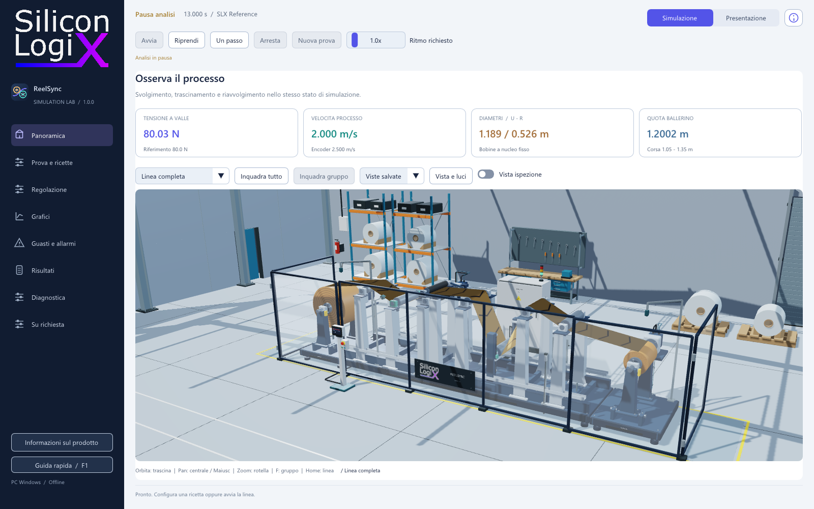
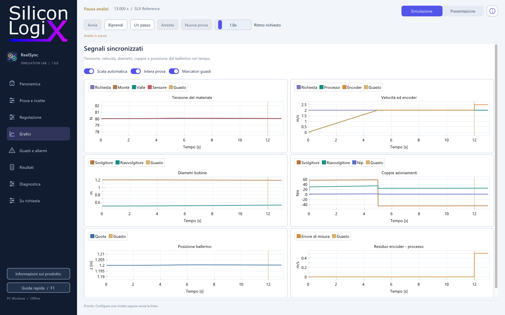

# SLX ReelSync 1.5.0

Copyright (c) 2026 Marco Pezzullo (Silicon LogiX).
SPDX-License-Identifier: LicenseRef-SLX-ReelSync-Demo-Evaluation-1.0

Simulatore PC di svolgimento, trascinamento e riavvolgimento di materiale continuo.
Il core C++ SiliconLogiX calcola bobine, tensione, azionamenti, sensori e ballerino.
Scena 3D, grafici, allarmi e report leggono lo stesso stato.



Estrarre il pacchetto completo e aprire **SLX-ReelSync.exe** nella cartella
principale. L'eseguibile ha l'icona ReelSync e controlla core, versione, licenza
 offline e risorse prima di aprire l'interfaccia. Windows x64 e driver OpenGL 3.3;
build e prove eseguite su Windows 11. Nessun account, Raspberry, attivazione,
Internet o invio automatico di dati richiesti. Il collegamento al pannello Wi-Fi è opzionale.

1. In **Prova e ricette**, scegliere o caricare una ricetta e applicarla a linea ferma.
2. Premere **Avvia**. In **Regolazione**, inviare velocità o tensione nuove.
3. In **Guasti e allarmi**, scegliere causa, intensità, inizio e durata.
4. Osservare **Grafici** e diagnosi, poi esportare la prova da **Risultati**.

**Pausa analisi** congela il tempo; **Un passo** avanza un intervallo numerico;
**Arresta** esegue una rampa fisica. **Nuova prova** reinizializza stato e dati
in memoria, dopo l'archiviazione automatica della prova precedente. La manutenzione visuale richiede linea ferma. **Presentazione**
riproduce la clip originale, separata dalla simulazione fisica.

La telecamera offre orbita con trascinamento, pan con tasto centrale oppure
Maiusc + sinistro, zoom con rotella, selezione con clic e messa a fuoco con
doppio clic o **F**. **Home** inquadra la linea. Dieci preset, sei viste salvate,
esposizione, luci, ombre e vista di ispezione. Il marchio originale rimane sulla
targa; colori e illuminazione possono cambiare senza modificare il GLB.

**About** è disponibile dalla barra superiore, dal pulsante laterale oppure
con **F12**: prodotto, vendor, versioni host/core/SDK/modello, sito, licenza e
avvisi delle dipendenze. **F1** apre la guida rapida.

La lastra presenta frecce e tacche che seguono il materiale calcolato dal core:
**Vista e luci** ne regola passo e visibilita. Rimangono ferme in pausa.
In **Regolazione** sono disponibili arresto a metratura e pausa al primo allarme.
L'arresto usa un anticipo nominale; il report mostra lo scarto effettivo. Il trigger
di pausa richiede il riarmo dopo lo scatto e non simula una frenata fisica.

**Su richiesta** presenta cinque estensioni con fonti tecniche, ambito e dati
necessari. Dettagli nelle [proposte di sviluppo](docs/ON_REQUEST.md) e nelle
[novità 1.5.0](docs/RELEASE_NOTES_1.5.0.md).

Il pannello HMI della scena mostra stato, processo e qualità dei sensori. Il
quadrante visualizza la forza pneumatica effettiva in **N**, compresa la perdita
iniettata. Non rappresenta una pressione in bar. In Presentazione i valori di
processo sono sostituiti da trattini.

La prova in corso viene salvata ogni cinque secondi e alla chiusura. Alla
riapertura puoi ricostruirla e riprenderla dalla pausa, con seed, cronologia e
guasti futuri. Il cambio di prova conserva un archivio dei risultati. Prima
di iniziare, usa **Salva ricetta** per conservare la configurazione preparata.



Nove anomalie: perdita encoder, bias tensione, attrito, rottura, derating degli
azionamenti, perdita di forza pneumatica, errore scala encoder, cella bloccata
e ritardo sensori. **Rimuovi causa** conserva stato e prova. Una fermata
memorizzata richiede condizioni stabili e **Conferma ripristino**; una rottura
richiede una nuova prova. Dettagli in [Laboratorio guasti](docs/FAULT_LAB.md).
Le prove di errore operatore verificano riferimenti fuori campo e manutenzione in marcia.

La **campagna guasti** esegue dodici scenari indipendenti; il **confronto dei
controllori** esegue la medesima prova con SLX Reference e il modulo C.
Entrambe le analisi lavorano in background e salvano gli esiti reali.

Ricette e preferenze usano finestre native e profilo utente. Su Windows,
risultati e viste sono in `%LOCALAPPDATA%/SiliconLogiX/ReelSync`.
Il pacchetto di installazione non viene riscritto dalla normale operatività.

Prove senza interfaccia:

```powershell
.\bin\slx-reelsync-cli.exe --scenario ramp --output results/ramp
.\bin\slx-reelsync-cli.exe --scenario setpoint --controller reference --output results/reference
.\bin\slx-reelsync-cli.exe --scenario setpoint --controller educational --output results/educational
.\bin\slx-reelsync-cli.exe --scenario drive --output results/drive
.\bin\slx-reelsync-cli.exe --scenario air --output results/air
.\bin\slx-reelsync-cli.exe --scenario encoder-scale --output results/encoder-scale
.\bin\slx-reelsync-cli.exe --scenario stuck --output results/stuck
.\bin\slx-reelsync-cli.exe --scenario lag --output results/lag
.\bin\slx-reelsync-cli.exe --scenario recovery --output results/recovery
.\bin\slx-reelsync-cli.exe --replay results/reference/trial.json --output results/replayed
```

Sono disponibili anche `encoder`, `bias`, `friction` e `break`. Ogni prova
esporta CSV, JSON con configurazione/versioni/seed/eventi, report leggibile,
`telemetry.json` ed `events.json`.
Le anomalie iniziano a 20 s; recovery rimuove il bias a 30 s;
arresto richiesto a 45 s. Il tempo si congela al completamento dell'arresto.

Per ricompilare host, launcher ed esempio, senza sorgenti privati:

```powershell
cmake -S . -B build-public -G Ninja -DCMAKE_BUILD_TYPE=Release -DCMAKE_C_COMPILER=clang -DCMAKE_CXX_COMPILER=clang++
cmake --build build-public
.\build-public\SLX-ReelSync.exe
```

LLVM-MinGW x64 nel PATH, CMake 3.24+ e Ninja. SDK binario e sorgenti delle
dipendenze sono inclusi: nessun download in build. Per la sola CLI usare
`-DSLX_BUILD_DESKTOP=OFF` e avviare `build-public/bin/slx-reelsync-cli.exe`.
Modificare il guadagno in `examples/educational_controller.c`, ricompilare e
confrontare le prove. Il core e il controllore proprietario rimangono binari.
L'esempio è codice locale di fiducia, senza caricamento automatico di plugin.

Dettagli: [SDK](docs/SDK.md), [modello](docs/MODEL.md),
[capability e limiti](docs/CAPABILITIES.md), [novità 1.5.0](docs/RELEASE_NOTES_1.5.0.md),
[componenti terzi](THIRD_PARTY_NOTICES.md).
Modello ridotto non calibrato. La dashboard Raspberry nativa C++/LVGL comunica
con il PC tramite TLS/WebSocket sulla rete locale. Sono eseguite verifiche software
con binari ARM; il collaudo fisico della nuova immagine su HDMI, touch e Wi-Fi
resta da eseguire. I [contratti dati](docs/TELEMETRY.md) documentano il collegamento.
Calibrazione, modelli avanzati, autotuning, PLC e SIL/HIL: **disponibili su progetto**.
Distribuzione proprietaria per valutazione tecnica, anche aziendale: [app](LICENSE),
[SDK/core](SDK_LICENSE), [asset originali](ASSET_LICENSE). Le licenze dei terzi restano indipendenti.
Contatti: [SiliconLogiX](https://www.siliconlogix.it).

## Collegare il pannello Raspberry

1. Aprire **Pannello Wi-Fi** sul PC e abilitare il collegamento (TCP 47631).
2. Sul pannello, configurare la rete in **Sistema / Connessione**, quindi l'indirizzo del PC.
3. Sul PC premere **Avvia associazione**. Sul pannello premere **Associa**, confrontare l'impronta e inserire il codice temporaneo.
4. Confermare la richiesta sul PC e completare l'associazione sul pannello.
5. Dal pannello richiedere il controllo; sul PC assegnarlo al dispositivo.

La consultazione resta disponibile in sola lettura. Un comando locale sul PC
riprende il controllo. Dati scaduti sospendono i comandi; una riconnessione non
reinvia richieste né riavvia la prova. Windows deve consentire all'eseguibile
slx-reelsync-link.exe di ricevere connessioni sulla rete privata scelta.

La linea è interamente virtuale: per usarla e verificarla non serve un
impianto reale. La versione 1.4.0 aggiunge risposta dinamica degli azionamenti,
limiti di potenza e attrito dissipativo. In Prova e ricette è disponibile anche
PET 25 um / 400 mm, basato su proprietà tipiche pubblicate.
[Profilo della macchina, fonti e verifiche](docs/VIRTUAL_PLANT.md).

Il catalogo comprende PET, PE-LD, BOPP, PA6 condizionato e due profili elastici. [Materiali, selezione e fonti](docs/MATERIALS.md).

## Licenza e distribuzione

Distribuzione proprietaria per valutazione tecnica interna, anche da parte di aziende ed enti. Consultare [LICENSE](LICENSE), [SDK_LICENSE](SDK_LICENSE) e [ASSET_LICENSE](ASSET_LICENSE). I diritti indipendenti delle dipendenze restano invariati; il codice SLX non e distribuito con licenza open source. La visibilita e i fork sulla piattaforma seguono i termini di GitHub. Il core e il servizio di comunicazione sono forniti come binari proprietari.

La scena pubblica contiene un solo GLB runtime e i tre JSON letti dal renderer. I file Blender, i generatori 3D e i dati di costruzione restano privati. Il GLB contiene necessariamente la geometria visualizzata dall'app.

Verifica dei file: `python scripts/verify_release.py`. Verifica dei confini e delle condizioni di distribuzione: `python scripts/verify_public_tree.py --require-publishable`.
